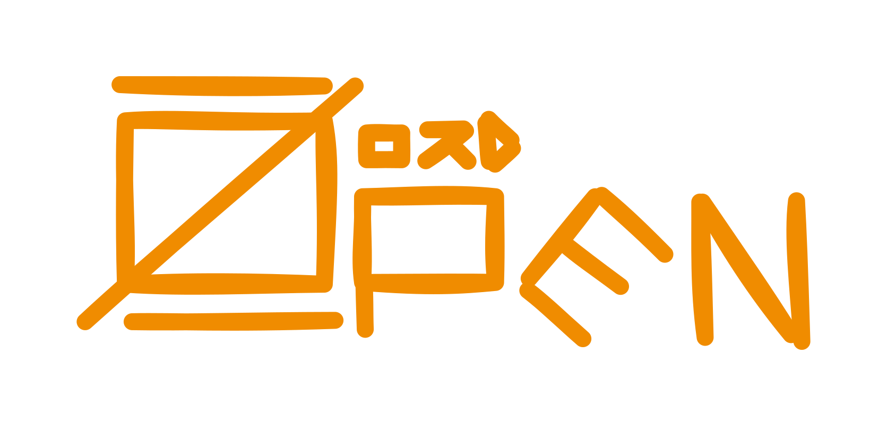

<p align="center">
  
</p>

# Zord
## Build your mecha

Zord is a Go microframework for hexagonal (ports & adapters) services, delivered
as a **CLI that scaffolds and maintains your project** — not a library you depend
on, and not a boilerplate you fork and let rot.

> **Tip for MCP-aware clients (Cursor, Claude, etc.):**
> add this rule to your client's **User rules** so every change is validated:
>
> **after each code update, run the `arch_analyze` MCP tool**

---

## Philosophy — code as asset

Zord follows the shadcn model, not the `go get` model:

- **You own the code.** `zord new` emits a complete, runnable project into your
  repo. There is no hidden framework dependency — the runtime lives in *your*
  tree, and you edit it like any other code.
- **Explicit over magic.** Updates are explicit, the architecture gate is a
  contract, and code generation is AST-pure (it edits the Go AST of the target
  layer, never blind whole-file templating), so output stays compilable and
  idempotent.
- **Guardrails remove the toil.** The architecture gate makes LLM/codegen
  reliable: generated or hand-written, code is only accepted if it passes.

The generated project's own architecture, layers and day-to-day commands are
documented in **[`internal/skeleton/runtime/README.md`](internal/skeleton/runtime/README.md)**
(it ships as your project's README).

---

## Install

```sh
go install github.com/Open-Zord/zord/cmd/zord@latest
```

Zord is a **single module** with no `replace` directives and no code-generation
step, so `go install` works straight from source. Pre-built binaries for
linux/darwin/windows (amd64/arm64) are published on each
[GitHub Release](https://github.com/Open-Zord/zord/releases). You can also build
it locally:

```sh
go build -o zord ./cmd/zord
```

## Create a project

```sh
zord new myservice --module github.com/me/myservice
cd myservice
docker compose up -d      # MySQL + the app
zord migrate              # create the tables from the HCL schema
curl localhost:9000/v1/health
```

`zord new <path> [--module <path>] [--no-tidy]` materializes the embedded runtime
into a fresh, standalone Go module and runs `go mod tidy`. The generated project
carries **only the runtime** — none of Zord's tooling is copied; you drive it with
the installed `zord` binary (`zord scaffold …`, `zord arch-analyse`, `zord migrate`).

---

## CLI commands

| Command | Purpose |
|---|---|
| `zord new <path>` | Scaffold a new project from the embedded runtime |
| `zord scaffold <group> <sub>` | AST-pure code generation, layer by layer (domain, field, repository, service, handler, route, …) |
| `zord arch-analyse` | Run the architecture gate over the project in the current directory |
| `zord migrate` | Apply the HCL schema to the database |
| `zord inspect` | Inspect the database from the HCL description |
| `zord generate-schema-from-db <schema> <database>` | Reverse an existing database into an HCL schema |
| `zord mcp [--repo <path>]` | Run the MCP server (scaffold + gate as MCP tools) |

Run `zord <command> --help` for the exact flags. The scaffold groups and the gate
rules are documented in the runtime README linked above.

---

## Repository layout

This repo is the **ecosystem monorepo** — the CLI plus the runtime it emits — in a
single Go module (`github.com/Open-Zord/zord`):

```
cmd/zord/                 the `zord` CLI entrypoint
internal/
  commands/               one package per subcommand (new, scaffold, arch-analyse, migrate, mcp)
  tools/                  the implementations behind the commands
    archanalyser/         the architecture gate (+ embedded allow-lists)
    scaffold/             the AST-pure generator
    migrator/ · atlas/    schema migration (Atlas)
    mcp/                  the MCP server
  projectgen/             materializes the runtime into a new project
  skeleton/
    embed.go              //go:embed all:runtime — embeds the boilerplate
    runtime/              the runtime boilerplate emitted by `zord new`
docker/mcp/               Dockerfile for the MCP server
skills/                   harness-agnostic agent skills
```

The `runtime/` subtree is **committed source compiled as part of this module**, so
it is dogfooded in-place: `go build ./...`, `go test ./...` and your IDE all see
it. Its module manifest is `go.mod.embed` (so `//go:embed` doesn't treat it as a
nested module); `zord new` writes it out as `go.mod` and rewrites the module path.

---

## Developing Zord

```sh
make build          # build the zord binary (runtime embedded)
make test           # tooling + runtime tests (dogfood, compiled in-place)
make vet
make arch-analyse   # dogfood the gate: generate an ephemeral project and lint it
```

**Why `make arch-analyse` generates a project** instead of running in-place: the
embedded runtime's module path is `github.com/Open-Zord/zord/internal/skeleton/runtime`,
which contains `/internal/` — that would poison the gate's segment-based isolation
rules. A generated project has a clean module path, exactly like real usage.

**Any new code is only accepted with all validations passing** — run the gate
before opening a PR.

### Run tests with coverage

```sh
go test ./... -coverprofile=coverage.out
go tool cover -html=coverage.out
```

---

## MCP server

`zord mcp` is the project's Model Context Protocol server. It exposes the scaffold
generator and the architecture analyser as MCP tools over **stdio**, so an
MCP-aware client (Cursor, Claude, etc.) can generate code and lint architecture
directly. It provides the `scaffold_*` family (one per scaffold subcommand) plus
`arch_analyze`. Full per-tool docs: [`internal/tools/mcp/README.md`](internal/tools/mcp/README.md).

```sh
zord mcp --repo .
```

`--repo` sets the target repository the tools operate on (defaults to the current
directory); each tool call can override it with an optional `repo` argument. The
repo ships a ready-to-use client config at [`zord-mcp.json`](zord-mcp.json):

```json
{
  "mcpServers": {
    "zord-mcp": {
      "type": "stdio",
      "command": "zord",
      "args": ["mcp", "--repo", "/abs/path/to/your/repo"],
      "env": {}
    }
  }
}
```

(During development you can point `command` at `go` with `args` `["run", "./cmd/zord", "mcp", "--repo", "."]`.)
A full end-to-end smoke test that drives the server through real tool calls lives
at [`internal/tools/mcp/demo.sh`](internal/tools/mcp/demo.sh).

---

## Agent Skills

`skills/` ships **harness-agnostic** agent skills — documented workflows any AI
tool (Claude Code, Cursor, a custom agent) can discover and run. Discovery is a
single machine-readable index, `skills/manifest.json`; each skill is a `SKILL.md`
written against an abstract capability vocabulary each harness maps to its own
primitives.

- Format, discovery and capability vocabulary: `skills/README.md`
- Claude Code adapter: `skills/adapters/claude-code/install.sh`
- Any other tool: `skills/adapters/generic.md`

---

## Roadmap

Zord is evolving from a base repository into a CLI-driven ecosystem. Done: a
single unified `zord` binary and `zord new`. Next: a package manager
(`zord package add/update/remove`) for curated batteries (auth, cache,
multi-tenant, …) as owned-code assets, `zord upgrade` with codemods, and
pre-built release binaries.
